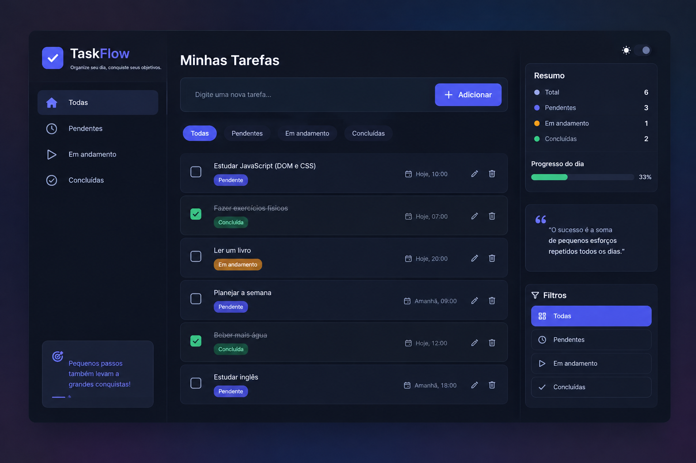

<div align="center">

# TaskFlow 📝


*Organize suas tarefas e acompanhe o seu progresso*

</div>

---

## 🖥️ Preview

<div align="center">



</div>

---

## 📋 Sobre o projeto

O **TaskFlow** é uma aplicação de lista de tarefas (to-do list) que permite ao usuário criar, editar, concluir e excluir tarefas do dia a dia. Cada usuário possui sua própria lista de tarefas, com login e cadastro, e todos os dados são armazenados no navegador via `localStorage`.

O projeto foi desenvolvido com JavaScript puro (vanilla), sem frameworks, focando na lógica de manipulação do DOM, módulos ES6 e persistência de dados local.

## ✅ Funcionalidades

- [x] Cadastro de usuário
- [x] Login e logout
- [x] Adicionar novas tarefas
- [x] Editar tarefas
- [x] Concluir / reabrir tarefas (checkbox)
- [x] Excluir tarefas
- [x] Filtros: Todas · Pendentes · Concluídas
- [x] Contadores dinâmicos no painel lateral
- [x] Tema claro / escuro (dark mode por padrão)
- [x] Tarefas independentes salvas para cada usuário
- [x] Tarefas mantidas renderizadas na tela ao recarregar a página

## 🚀 Como executar

> ⚠️ Como o projeto usa módulos ES6, é necessário rodar em um servidor local (abrir o `index.html` direto do disco não funciona).

1. Clone o repositório:

```bash
git clone https://github.com/seu-usuario/task-flow.git
```

2. Abra a pasta no VS Code e use a extensão **Live Server** (ou Python):

```bash
# opção via Python
python -m http.server 5500
```

3. Acesse no navegador:

```txt
http://localhost:5500
```

4. Crie sua conta, faça login e comece a organizar suas tarefas! 🎉

## 🛠️ Tecnologias

- **HTML5** — estrutura das páginas
- **CSS3** — estilização e responsividade
- **JavaScript (ES6+)** — lógica, módulos e manipulação do DOM
- **localStorage** — persistência de usuários e tarefas

## 📁 Estrutura de pastas

```txt
task-flow/
│
├── assets/               # Imagens do projeto
│   └── Painel-taskFlow.png
│
├── css/
│   ├── auth.css          # Estilos de login/cadastro
│   └── style.css         # Estilos do painel principal
│
├── js/
│   ├── app.js            # Renderização, filtros e eventos das tarefas
│   ├── auth.js           # Proteção de rota e logout
│   ├── cadastro.js       # Lógica de criação de conta
│   ├── lightDark.js      # Alternância de tema claro/escuro
│   ├── login.js          # Lógica de autenticação
│   ├── storage.js        # Persistência (localStorage)
│   └── task.js           # CRUD de tarefas
│
├── cadastro.html
├── index.html
└── login.html
```

## 🔮 Próximas melhorias

- [ ] Senhas criptografadas (hash)
- [ ] Drag & drop para reordenar tarefas
- [ ] Data/hora de criação nas tarefas
- [ ] Exportar/importar lista de tarefas

---

<div align="center">

Feito com 💙 — *Pequenos passos também levam a grandes conquistas.*

</div>
